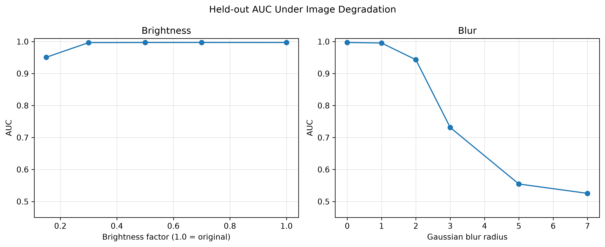
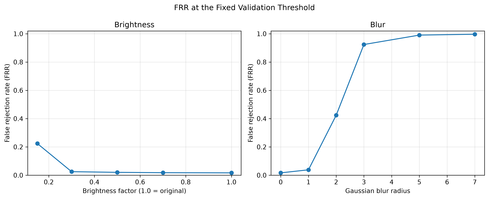

# Evaluating Face Verification Robustness Under Image Degradation

## Overview

This project investigates how image degradation affects the performance of a pretrained face verification model. It evaluates the effects of Gaussian blur and reduced image brightness on facial embeddings and cosine-similarity-based verification.

The aim is to understand which types of image degradation cause performance to deteriorate and how the model's false rejection rate changes under challenging image conditions.

## Research Questions

- How does increasing blur affect face verification performance?
- How does reduced brightness affect verification accuracy?
- How does performance change when one image in a verification pair is degraded?
- How reliable are the observed results on a held-out set of identities?

## Dataset

The experiments use the **Labeled Faces in the Wild (LFW)** dataset, accessed through `scikit-learn`.

- Images are grouped by identity.
- The dataset contains 9,164 images across 1,680 identities in the configuration used.
- Identity-disjoint validation and test sets are used to reduce identity leakage between threshold selection and final evaluation.
- The dataset is loaded using scikit-learn's fetch_lfw_people utility. It is downloaded automatically on the first run and cached locally for subsequent use. An internet connection is required for the initial download.

## Model and Methodology

A pretrained **InceptionResnetV1** model from `facenet-pytorch`, pretrained on VGGFace2, generates 512-dimensional facial embeddings.

Cosine similarity is used to compare two embeddings:

- **Genuine pairs:** Two images of the same person.
- **Impostor pairs:** Images of two different people.

A similarity threshold of **0.4085** was selected on the validation set and held fixed for test-set evaluation.

For the degradation experiments, the second image in each pair is transformed while the first remains unchanged. The transformed image is re-embedded before the pair is evaluated.

### Image Degradation Experiments

**Gaussian blur:** Blur radii of 0, 1, 2, 3, 5, and 7.

**Brightness:** Brightness factors of 1.0, 0.7, 0.5, 0.3, and 0.15, where lower factors represent darker images.

### Evaluation Metrics

- **AUC:** Measures how well genuine and impostor pairs are ranked across similarity thresholds.
- **EER:** The operating point where false acceptance and false rejection rates are equal or approximately equal.
- **FAR:** The proportion of impostor pairs incorrectly accepted.
- **FRR:** The proportion of genuine pairs incorrectly rejected at the fixed validation threshold.

## Key Results

The held-out test set contains 840 genuine pairs and 840 impostor pairs.

| Condition | AUC | EER | FAR at fixed threshold | FRR at fixed threshold |
|---|---:|---:|---:|---:|
| Baseline | 0.9971 | 0.0179 | 0.0143 | 0.0167 |
| Brightness 0.30 | 0.9967 | 0.0214 | 0.0167 | 0.0250 |
| Brightness 0.15 | 0.9509 | 0.1101 | 0.0060 | 0.2238 |
| Blur radius 2 | 0.9432 | 0.1232 | 0.0190 | 0.4238 |
| Blur radius 3 | 0.7314 | 0.3292 | 0.0119 | 0.9238 |
| Blur radius 7 | 0.5254 | 0.4756 | 0.0071 | 0.9964 |

### Main Findings

- The baseline model performs strongly on the held-out LFW pairs.
- Moderate brightness reductions have relatively little effect, while severe darkening reduces verification performance.
- Increasing blur causes substantial performance deterioration.
- At blur radius 7, the AUC approaches 0.5, indicating near-chance ranking performance, while the FRR reaches 99.64% at the fixed validation threshold.

These results show that image quality can substantially affect face verification, particularly under severe blur.

## Figures

### AUC Under Image Degradation



### False Rejection Rate Under Image Degradation



## Project Structure

```text
face_recognition project/
├── data/
├── experiments/
├── results/
│   ├── figures/
│   │   ├── heldout_auc.png
│   │   └── heldout_frr.png
│   ├── heldout_blur_metrics.csv
│   ├── heldout_brightness_metrics.csv
│   └── combined_heldout_robustness.csv
├── src/
│   ├── embedding.py
│   ├── generate_split_pairs.py
│   ├── evaluate_split_metrics.py
│   ├── evaluate_blur_verification.py
│   ├── evaluate_brightness_verification.py
│   ├── combine_heldout_results.py
│   ├── plot_heldout_robustness.py
│   ├── evaluate_uncertainty.py
│   └── verify_pair_split.py
├── REPORT.md
├── README.md
└── requirements.txt
```

## Reproducibility

Run commands from the project root after installing the dependencies and configuring the environment.

```bash
python src/generate_split_pairs.py
python src/evaluate_split_metrics.py
python src/evaluate_blur_verification.py
python src/evaluate_brightness_verification.py
python src/combine_heldout_results.py
python src/plot_heldout_robustness.py
python src/verify_pair_split.py
python src/evaluate_uncertainty.py
```

**Note:** The pair-generation script recreates the validation and test pair files. The experiments may take time because transformed images need to be re-embedded. Existing results are already saved, so these commands are not necessary just to view the project.

## Limitations

- The study evaluates one pretrained model on one dataset.
- Blur and brightness changes are controlled transformations and do not represent every real-world imaging condition.
- Only the second image in each pair is degraded.
- Images may be reused across different pairs, so pairs are not fully independent.
- The preliminary pair-bootstrap confidence interval resamples scores rather than identity clusters and may underestimate uncertainty.
- Demographic fairness was **not evaluated** in this study.

## Future Work

Future work could evaluate additional face recognition models and datasets, use more realistic image degradations, estimate uncertainty with identity-aware resampling, and conduct a separate, carefully designed demographic fairness analysis.

## Ethical Considerations

Face verification involves sensitive biometric information. Results should not be interpreted as evidence that a model is suitable for real-world identity verification without broader testing, privacy safeguards, and evaluation of potential harms.

## Author

Smriti Rawat

This project is an experimental study of face verification robustness for research and educational purposes.
